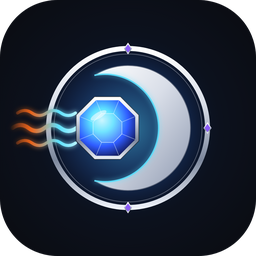
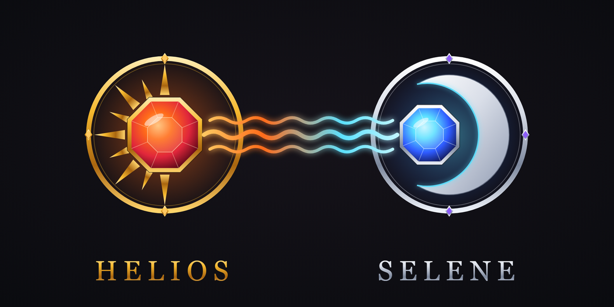
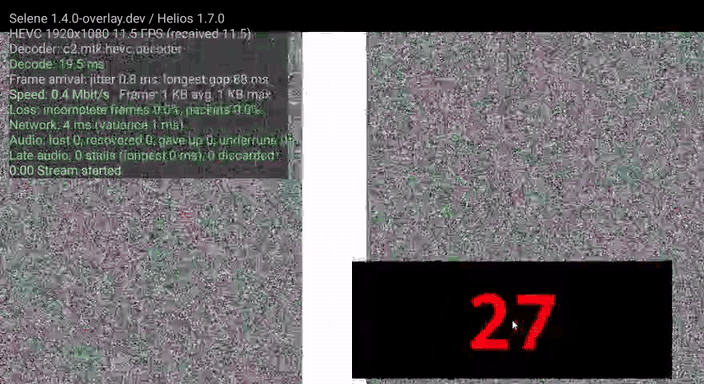
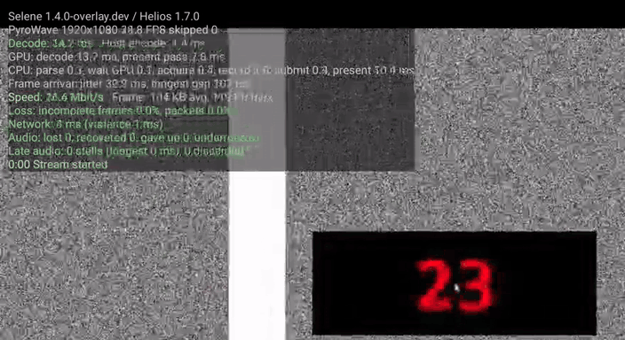

  

# Selene Game Streaming

An open source Android client for [Helios](https://github.com/eumarcodev/Helios-Server), [Apollo](https://github.com/ClassicOldSong/Apollo) and [Sunshine](https://github.com/LizardByte/Sunshine) hosts.

Selene Game Streaming will allow you to stream your collection of games from your Windows PC to your Android device,
whether in your own home or over the internet.

It is an independent fork of [Artemis](https://github.com/ClassicOldSong/moonlight-android) (previously named Moonlight Noir), which is itself a fork of
[Moonlight Android](https://github.com/moonlight-stream/moonlight-android), with loads of optimizations for office usage.

A more seamless experience with virtual display will be Selene paired with [Helios](https://github.com/eumarcodev/Helios-Server).

## Lineage and credits

The names continue the sun and moon family of the streaming projects: Selene is the moon, the companion of the sun host Helios.

  

The icons tell the same story: Helios, the sun, emits the stream, and Selene, the moon, receives it and reflects it (the orange waves cool into cyan as they reach the sapphire). The icon sources and the generator live in [`branding/`](branding).

| Project | Role | Authors |
|---------|------|---------|
| [Moonlight](https://github.com/moonlight-stream) (moonlight-android) | Original open source client for NVIDIA GameStream | Cameron Gutman and the Moonlight contributors |
| [Artemis (Moonlight Noir)](https://github.com/ClassicOldSong/moonlight-android) | Moonlight Android fork with virtual display, clipboard sync and many client features | ClassicOldSong |
| **Selene Game Streaming** | This project, an independent fork of Artemis | Maintained by [eumarcodev](https://github.com/eumarcodev) |

The matching host side: [Sunshine](https://github.com/LizardByte/Sunshine) (LizardByte and contributors) -> [Apollo](https://github.com/ClassicOldSong/Apollo) (ClassicOldSong) -> [Helios](https://github.com/eumarcodev/Helios-Server).

### Thanks

- **ClassicOldSong**, for Artemis and Apollo, which are the base of this fork.
- **Cameron Gutman**, **Diego Waxemberg**, **Aaron Neyer**, **Andrew Hennessy** and every Moonlight contributor, for the client and the streaming protocol work.
- **LizardByte** and the Sunshine contributors.

This fork keeps the original license (GPLv3) and copyright notices. The upstream history is preserved in this repository's git log.

# Features

If you switch back to the main stream version, you'll be missing the following awesome features which are very unlikely to be added there:

1. Custom virtual buttons with import and export support.
2. [Custom resolutions](https://github.com/moonlight-stream/moonlight-android/pull/1349).
3. Custom bitrates.
4. [Multiple mouse mode switching](https://github.com/moonlight-stream/moonlight-android/pull/1304) (normal mouse, [multi-touch](https://github.com/moonlight-stream/moonlight-android/pull/1364), touchpad, disabled, local cursor mode).
5. Optimized virtual gamepad skins and free joystick.
6. External monitor mode.
7. Joycon D-pad support.
8. Simplified performance information display.
9. [Game back menu](https://github.com/moonlight-stream/moonlight-android/pull/1171).
10. Custom shortcut commands.
11. Easy soft keyboard switching.
12. Portrait mode.
13. Display on top mode, useful for foldable phones.
14. [Virtual touchpad space and sensitivity adjustment](https://github.com/moonlight-stream/moonlight-android/issues/1348#issuecomment-2236344729) for playing right-click view games, such as Warcraft.
15. Force use device's own vibration motor (in case your gamepad's vibration is not effective).
16. Gamepad debugging page to view gamepad vibration and gyroscope information, as well as Android kernel version information.
17. Trackpad tap/scrolling support
18. Natural track pad mode with touch screen
19. Non-QWERTY keyboard layout support
20. Quick Meta key with physical BACK button
21. Frame rate lock fix for some devices
22. Video scale mode: Fit/Fill/Stretch
23. View pan/zoom support
24. Rotate screen in-game
25. Add option to quit app directly
26. Samsung DeX scrolling support
27. Proper click/scroll/right-click for trackpad on generic Android tablet when using local cursor
28. Virtual Display integration with [Helios](https://github.com/eumarcodev/Helios-Server) / [Apollo](https://github.com/ClassicOldSong/Apollo)
29. Server Command integration with [Helios](https://github.com/eumarcodev/Helios-Server) / [Apollo](https://github.com/ClassicOldSong/Apollo)
30. Clipboard sync (requires Helios or Apollo)
31. SBS 3D for external Displays (Using AI MiDaS v2 Lite)

# Performance overlay

The performance overlay shows the same information for every codec (H.264, HEVC, AV1 and PyroWave): app and host versions, decoder, decode and host encode time, frame arrival jitter, speed and frame size, packet and frame loss, network latency, audio loss and late audio. PyroWave adds its GPU and CPU stage times. The text is built on its own thread, so turning the overlay on does not slow down the decoder.

The recordings below are 60 second tests with a game-like load: full-screen noise that changes every frame (high bitrate) and a frame counter ([`docs/media/game_load.py`](docs/media/game_load.py)). They show one frame per second, the rate at which the overlay updates.

| HEVC | PyroWave |
|---|---|
|  |  |

### Results (60 s, 1920x1080, 60 FPS, 60 Mbit/s requested)

| | HEVC | PyroWave |
|---|---|---|
| Speed | 56.8 Mbit/s | 47.8 Mbit/s |
| Frames | 60.1 FPS received | 57.5 FPS |
| Frame arrival | jitter 2.7 ms, longest gap 26 ms | jitter 6.8 ms, longest gap 34 ms |
| Video loss | 0.0% | 0.0% |
| Network latency | 3 ms | 4 ms |
| Audio loss | 0 | 0 |
| Late audio | 4 stalls of 31-32 ms | 3 stalls of 31-33 ms |

### Test setup

| | |
|---|---|
| **Host PC** | AMD Ryzen 7 5700X, AMD Radeon RX 9070 XT (driver 32.0.32015.16001), 32 GB RAM, Windows 11 Pro (build 26340) |
| **Host software** | Helios 1.7 / 1.8 (still screen boost), HEVC encoder `hevc_amf`, virtual display 1920x1080 at 60 Hz |
| **Client** | Xiaomi Redmi Pad 2 (MediaTek MT8781, Mali-G57 MC2, 8 GB RAM), HyperOS 3.0 (Android 16), decoder `c2.mtk.hevc.decoder` |
| **Client software** | Selene 1.5 (overlay recordings), Selene 1.6 (PyroWave quality) |
| **Network** | Host wired at 1 Gbit/s to the router; tablet on Wi-Fi 5 (802.11ac), 5 GHz channel 149, link 433 Mbit/s, RSSI -22 dBm, less than 1 m from the router |
| **Stream** | 1920x1080, 60 FPS, 60 Mbit/s, stereo audio |

### PyroWave picture quality

PyroWave codes every frame on its own, which gives the lowest latency, but at the same bitrate it is less sharp than HEVC. Measured on the setup above with a real game frame and a text panel (tablet screenshots compared with the original, higher is better):

| Setting | Text, still (SSIM) | Game, still (PSNR) | Text, scrolling (SSIM) |
|---|---|---|---|
| HEVC, 60 Mbit/s | 0.964 | 41.6 dB | 0.959 |
| PyroWave, 60 Mbit/s | 0.943 | 36.0 dB | 0.942 |
| PyroWave, 150 Mbit/s | 0.957 | 38.9 dB | 0.953 |
| **PyroWave, 150 Mbit/s + sharper still screen** | **0.964** | **42.2 dB** | 0.953 |

So Selene now uses its own bitrate for PyroWave streams (**PyroWave bitrate**, Automatic = 2.5 times the video bitrate, up to 150 Mbit/s), and asks a Helios host to sharpen still pictures (**Sharper still screen**). At 150 Mbit/s this Wi-Fi 5 link carried 141 to 152 Mbit/s at 60 FPS with 0% loss and no audio stall.

### Recommended settings

| Network | Codec and bitrate |
|---|---|
| Wired, or Wi-Fi 5/6 with a link of 400 Mbit/s or more and RSSI above -60 dBm (measured) | PyroWave with "PyroWave bitrate: Automatic" (150 Mbit/s) for the lowest latency, or HEVC 60 Mbit/s |
| Wi-Fi 5 with a weaker link (200 to 400 Mbit/s, or RSSI -60 to -70 dBm) | PyroWave 60 to 100 Mbit/s, or HEVC 30 to 50 Mbit/s |
| Wi-Fi 2.4 GHz, a far access point or a busy network | HEVC 15 to 30 Mbit/s |
| Remote (internet) | HEVC or AV1 at what the upload allows; PyroWave is not meant for this |

Leave "Sharper still screen" on "Host setting" and "Maximum frame size" / "packet size" on automatic unless the overlay shows loss. The Wi-Fi line of the overlay shows your link speed and signal.

### Troubleshooting with the overlay

| Symptom | Overlay | What to try |
|---|---|---|
| Audio cuts | "Late audio" stalls of 150-200 ms | Selene 1.4 and Helios 1.7 or later; keep the Helios `audio_qos` option on `video` |
| Short freezes only when the screen barely moves | stalls and "longest gap" of ~140 ms, no loss | Wi-Fi power saving of some devices (#56); keep the device charging, motion makes it go away |
| PyroWave blurry | "PyroWave bitrate" low, "Speed" well below it | Raise "PyroWave bitrate", keep "Sharper still screen" on |
| Picture breaks up at high bitrates | "Loss" above 1% | Lower "PyroWave bitrate" (100, then 60), then try "Maximum frame size" 256 KB |
| Stutter without loss | "Frame arrival" jitter above ~10 ms | Use 5 GHz, get closer to the router, avoid other heavy traffic |
| PyroWave can't keep up | "Decode" in red, "skipped" frames | Lower the resolution or use HEVC |

The full guide, with the host settings, is in Helios: [docs/streaming-guide.md](https://github.com/eumarcodev/Helios-Server/blob/master/docs/streaming-guide.md).

# About this fork

Selene Game Streaming started as a fork of Artemis. Since the original project is no longer being updated, this fork continues independently, with its own releases and roadmap.

It is not affiliated with Moonlight, Artemis, Apollo or Sunshine. Compatibility with other GameStream-compatible hosts is kept where possible, but is not guaranteed.

Selene uses its own application id (`com.eumarcodev.selene`), so it installs next to Artemis and Moonlight and does **not** reuse their settings or pairings: pair it again with your host.

Pull requests and ideas are welcome.

## Downloads
* [Download APK directly](https://github.com/eumarcodev/Selene-Game-Streaming/releases)
* [Use Obtainium](https://apps.obtainium.imranr.dev/redirect?r=obtainium://app/%7B%22id%22%3A%22com.eumarcodev.selene%22%2C%22url%22%3A%22https%3A%2F%2Fgithub.com%2Feumarcodev%2FSelene-Game-Streaming%22%2C%22author%22%3A%22eumarcodev%22%2C%22name%22%3A%22Selene%20Game%20Streaming%22%2C%22additionalSettings%22%3A%22%7B%5C%22apkFilterRegEx%5C%22%3A%5C%22nonRoot%5C%22%2C%5C%22matchGroutToUse%5C%22%3A%5C%22%241%5C%22%2C%5C%22versionExtractionRegEx%5C%22%3A%5C%22v(.%2B)%5C%22%7D%22%7D)%5C%22%7D%22%7D) (recommended)

## Building
* Install Android Studio and the Android NDK
* Run ‘git submodule update --init’ from within the repository folder, then ‘git submodule update --init --recursive app/src/main/jni/moonlight-core/moonlight-common-c’ and ‘bash third_party/pyrowave/checkout_granite.sh’ (PyroWave's Granite has many nested submodules that are not needed, so do not use ‘--recursive’ on everything)
* Install the CMake package (‘cmake;3.22.1’) from the Android SDK Manager; it builds the PyroWave module
* In the repository folder, create a file called ‘local.properties’. Add an ‘ndk.dir=’ property to the local.properties file and set it equal to your NDK directory.
* Build the APK using Android Studio or gradle

## Authors

* [Cameron Gutman](https://github.com/cgutman)  
* [Diego Waxemberg](https://github.com/dwaxemberg)  
* [Aaron Neyer](https://github.com/Aaronneyer)  
* [Andrew Hennessy](https://github.com/yetanothername)

Moonlight is the work of students at [Case Western](http://case.edu) and was
started as a project at [MHacks](http://mhacks.org).
